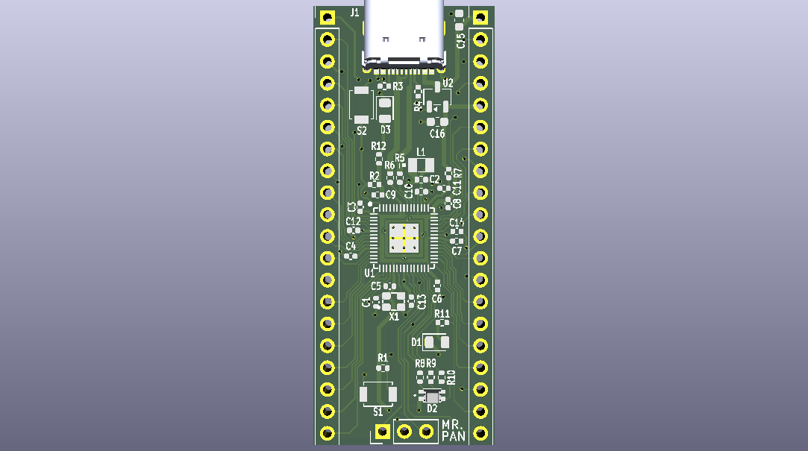
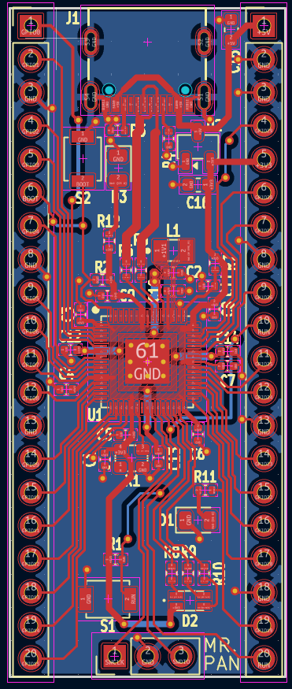
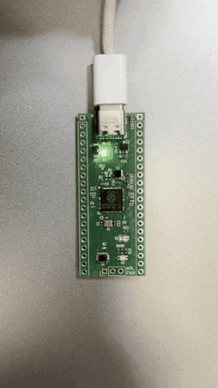

# Custom RPi Pico 2
Eddy Pan


A custom RP2354A development board in the style of the Raspberry Pi Pico 2, designed in KiCad 10.

<p align="center">
  
  <br>
  <em>3D render</em>
</p>

<table align="center">
  <tr>
    <td align="center">
      
    </td>
    <td align="center">
      <a href="assets/blinking.mp4">
        
      </a>
    </td>
  </tr>
  <tr>
    <td align="center"><em>PCB layout</em></td>
    <td align="center"><em>Blinky on the user LED at 1 Hz</em> (<a href="assets/blinking.mp4">full video</a>)</td>
  </tr>
</table>

## Docs

`docs/` holds the schematic PDF, BoM, and board design submission.

## Firmware

### Dependencies (Fedora 44)

```sh
sudo dnf install cmake git python3 gcc-c++ libusb1-devel \
    arm-none-eabi-gcc-cs arm-none-eabi-gcc-cs-c++ arm-none-eabi-newlib
```

Clone the [Pico SDK](https://github.com/raspberrypi/pico-sdk) (this project used v2.3.1) into `/opt`. `CMakeLists.txt` expects it at `/opt/pico-sdk`:

```sh
sudo git clone https://github.com/raspberrypi/pico-sdk.git /opt/pico-sdk
sudo chown -R $USER: /opt/pico-sdk
cd /opt/pico-sdk && git submodule update --init
```

Build and install `picotool` (version must match the SDK) and its udev rules, so you can flash without `sudo`.
It needs `libusb1-devel` to talk to the board over USB; without it, picotool builds but can't flash.

```sh
sudo git clone --branch 2.3.1 https://github.com/raspberrypi/picotool.git /opt/picotool
sudo chown -R $USER: /opt/picotool
cmake -S /opt/picotool -B /opt/picotool/build -DPICO_SDK_PATH=/opt/pico-sdk
cmake --build /opt/picotool/build -j
sudo cmake --install /opt/picotool/build        # -> /usr/local/bin/picotool
sudo cp /opt/picotool/udev/60-picotool.rules /etc/udev/rules.d/
sudo udevadm control --reload && sudo udevadm trigger
```

If picotool isn't installed, the SDK downloads and builds a copy into `build/_deps/picotool/` instead.

### Project layout

- `CMakeLists.txt` – targets the RP2350 and our custom board, builds `blink`
- `boards/custom_pico2.h` – board definition (based on `pico2.h`, 2 MB flash, LED on GPIO 19)
- `src/blink.c` – blinks the user LED on GPIO 19

### Build and flash

```sh
cmake -S . -B build
cmake --build build -j
```

The first time (or if the board is running firmware without USB stdio), hold BOOTSEL while plugging in USB, then flash with picotool:

```sh
picotool load -x build/blink.uf2
```

(Alternatively, drag `build/blink.uf2` onto the `RP2350` drive.)

After that, firmware built with `pico_enable_stdio_usb` exposes a reset interface over USB, so picotool can reboot the board into BOOTSEL itself. No button needed:

```sh
picotool load -f -x build/blink.uf2
```
